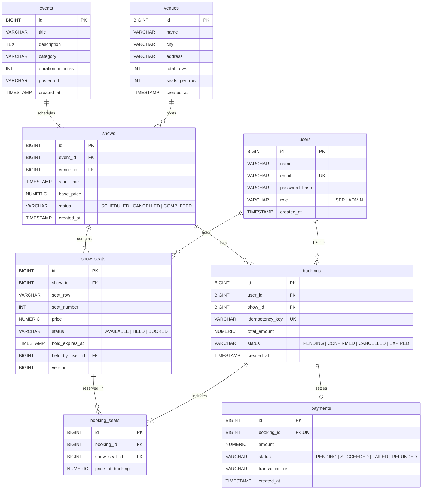

# 🎟️ High-Throughput Ticket Booking & Reservation Engine

[](https://openjdk.org/)
[](https://spring.io/projects/spring-boot)
[](https://www.mysql.com/)
[](https://react.dev/)
[](https://www.typescriptlang.org/)
[](https://www.docker.com/)
[](LICENSE)

A robust, enterprise-grade **Event Ticket Booking & Reservation Platform** engineered to eliminate race conditions, double-bookings, and distributed transaction deadlocks during flash-sale traffic spikes. 

Featuring **Pessimistic Row-Level Locking**, **Deterministic Deadlock Prevention**, **5-Minute Hold TTLs**, **Idempotency-Key Header Replay**, **Stateless JWT Security**, and a responsive **React 19 + TypeScript** seat selection client.

---

## 📑 Table of Contents
1. [Tech Stack Matrix](#-tech-stack-matrix)
2. [System Architecture](#-system-architecture)
3. [Entity-Relationship Diagram](#-entity-relationship-diagram)
4. [Deep Dive: Concurrency & Double-Booking Prevention](#-deep-dive-concurrency--double-booking-prevention)
   - [Pessimistic Row-Level Locking](#1-pessimistic-row-level-locking-pessimistic_write)
   - [Deterministic Deadlock Avoidance (Coffman Condition)](#2-deterministic-deadlock-avoidance-breaking-circular-wait)
   - [Two-Tier 5-Minute Hold TTL Engine](#3-two-tier-5-minute-hold-ttl-engine)
   - [Idempotency-Key Deduplication](#4-idempotency-key-deduplication)
5. [Concurrency Test Verification & Logs](#-concurrency-test-verification--logs)
6. [API Specifications & Swagger UI](#-api-specifications--swagger-ui)
7. [Running Locally](#-running-locally)
   - [Option A: Docker Multi-Container (Recommended)](#option-a-docker-multi-container-single-command)
   - [Option B: Local Fallback Profile (No Docker Required)](#option-b-local-fallback-profile-h2-postgresql-mode)
8. [Demo Credentials](#-demo-credentials)
9. [Automated Test Suite](#-automated-test-suite)

---

## 🛠️ Tech Stack Matrix

| Layer | Technology | Version | Key Design Decisions |
| :--- | :--- | :--- | :--- |
| **Language** | Java | 21 (LTS) / JDK 22 | Records for immutable DTOs, virtual thread ready, pattern matching. |
| **Backend Framework** | Spring Boot | 3.4.3 | Spring Data JPA, Spring Security, Bean Validation (`@Valid`), `@Scheduled` background reaper. |
| **Database** | MySQL (InnoDB) | 8.0+ | ACID-compliant relational storage, row-level locks (`SELECT ... FOR UPDATE`), transactional DDL. |
| **Dev / Test Database** | H2 Database | 2.3.232 | In-memory MySQL compatibility mode (`MODE=MySQL;DATABASE_TO_LOWER=TRUE`) for instant local fallback. |
| **Database Migration** | Flyway | 10.20.1 | Version-controlled idempotent schema migration (`V1__init_schema.sql`). |
| **Security & Auth** | Spring Security + JJWT | 0.12.6 | Stateless HMAC-SHA256 JWT tokens, role-based access control (`ROLE_ADMIN`, `ROLE_USER`), CORS. |
| **API Documentation** | Springdoc OpenAPI | 2.8.5 | Automated Swagger UI interactive documentation with Bearer JWT support. |
| **Frontend** | React + TypeScript + Vite | React 19, TS 5 | Component-driven SPA, CSS Variables, SVG cinema curved seat grid, live countdown timers. |
| **HTTP & Networking** | Axios + Nginx | Axios 1.7, Nginx 1.25 | Axios request/response interceptors for JWT injection, Nginx reverse proxy routing `/api` to backend. |
| **Testing** | JUnit 5, AssertJ, Mockito, Testcontainers | JUnit 5.11 | Multi-threaded concurrency testing (`CountDownLatch`, `ExecutorService`), pessimistic lock assertions. |
| **DevOps & Containers** | Docker & Docker Compose | Multi-Stage | Multi-stage builder patterns minimizing final container footprint; non-root user execution. |

---

## 🏛️ System Architecture

```
                                  [ Browser / Client ]
                                            │
                                            ▼
                           [ Nginx Reverse Proxy (Port 80/3000) ]
                                  │                     │
                     Static Assets│                     │/api/* requests
                                  ▼                     ▼
                        [ React 19 SPA ]    [ Spring Boot 3.4.3 (Port 8080) ]
                                                        │
                      ┌─────────────────────────────────┴─────────────────────────────────┐
                      │                                                                   │
                      ▼                                                                   ▼
       [ JwtAuthenticationFilter ]                                            [ @Scheduled Lease Reaper ]
                      │                                                        (Runs every 30s to free holds)
                      ▼                                                                   │
           [ REST Controllers ]                                                           │
                      │                                                                   │
                      ▼                                                                   │
             [ BookingService ] ◄─────────────────────────────────────────────────────────┘
                      │
                      ├── 1. Sort Seat IDs (Deadlock Prevention)
                      ├── 2. Check Idempotency Cache
                      ├── 3. Acquire Pessimistic Write Lock (SELECT ... FOR UPDATE)
                      └── 4. Validate Hold Leases & Transition State
                      │
                      ▼
            [ PostgreSQL 16 ] (Tables: show_seats, bookings, booking_seats, payments)
```

---

## 📊 Entity-Relationship Diagram



---

## ⚡ Deep Dive: Concurrency & Double-Booking Prevention

Ticketing architectures face extreme contention during peak booking windows. Multiple users frequently vie for the identical seat within fractions of a millisecond. Our engine guarantees data consistency and zero double-bookings through four coordinated mechanisms:

### 1. Pessimistic Row-Level Locking (`PESSIMISTIC_WRITE`)
While **Optimistic Locking** (`@Version`) is efficient for low-contention domains, in high-demand flash sales it leads to severe resource waste: 99% of transactions compute business logic only to fail on database commit due to version mismatches, creating cascading transaction aborts.

We utilize **Pessimistic Write Locking** directly on the database rows:
```java
@Lock(LockModeType.PESSIMISTIC_WRITE)
@QueryHints({
    @QueryHint(name = "jakarta.persistence.lock.timeout", value = "3000")
})
@Query("SELECT s FROM ShowSeat s WHERE s.id IN :seatIds ORDER BY s.id ASC")
List<ShowSeat> findByIdsWithPessimisticLock(@Param("seatIds") List<Long> seatIds);
```
- Executes native SQL: `SELECT * FROM show_seats WHERE id IN (...) ORDER BY id ASC FOR UPDATE`.
- Suspends competing transactions at the database engine level until the lock-holding transaction completes or times out (`3000ms`), preventing dirty reads, non-repeatable reads, and phantom reservations.

### 2. Deterministic Deadlock Avoidance (Breaking Circular Wait)
A classic distributed deadlock occurs when concurrent transactions attempt to lock multiple overlapping resources in different orders:
- **Transaction 1** locks Seat #10, then attempts to lock Seat #20.
- **Transaction 2** locks Seat #20, then attempts to lock Seat #10.
- Result: **Deadlock** (`PSQLException: ERROR: deadlock detected`).

According to Coffman's condition, deadlocks cannot occur if the **Circular Wait** condition is broken. Before executing any lock query, our service sorts all requested seat IDs in strictly ascending numerical order:
```java
// BookingService.java
List<Long> sortedSeatIds = new ArrayList<>(request.seatIds());
Collections.sort(sortedSeatIds); // Guarantees global deterministic acquisition hierarchy

List<ShowSeat> seats = showSeatRepository.findByIdsWithPessimisticLock(sortedSeatIds);
```
Every concurrent worker thread locks resources in the exact same sequence. Circular dependency is mathematically impossible.

### 3. Two-Tier 5-Minute Hold TTL Engine
To prevent users from holding seats indefinitely without completing payment, seats are reserved under a temporary 5-minute lease:
1. **Lazy Opportunistic Takeover**:
   When reading seat statuses or evaluating conflicts during a booking attempt, any seat marked `HELD` whose lease has elapsed (`hold_expires_at < Instant.now()`) is immediately treated as `AVAILABLE`. A new user can immediately take over the abandoned hold without waiting for asynchronous background reapers.
2. **Active Sweeper (`@Scheduled`)**:
   A scheduled task runs every 30 seconds (`BookingCleanupService`) to reclaim orphaned rows and transition stale bookings:
   ```java
   @Scheduled(fixedDelay = 30000)
   @Transactional
   public void cleanupExpiredHolds() {
       Instant now = Instant.now();
       List<ShowSeat> expiredSeats = showSeatRepository.findExpiredHeldSeats(now);
       for (ShowSeat seat : expiredSeats) {
           seat.setStatus(SeatStatus.AVAILABLE);
           seat.setHoldExpiresAt(null);
           seat.setHeldByUser(null);
       }
       bookingRepository.expirePendingBookings(now);
   }
   ```

### 4. Idempotency-Key Deduplication
To protect against network dropouts, mobile retries, and double clicks:
- Clients send a unique `Idempotency-Key: <UUID>` header with reservation requests.
- Before obtaining any locks or allocating entities, `BookingService` queries `bookingRepository.findByIdempotencyKeyAndUserId(...)`.
- If an active booking with that key already exists, the server returns the cached response with `HTTP 200 OK` instantly, bypassing database locks and preventing double allocations.

---

## 🔬 Concurrency Test Verification & Logs

To prove the locking engine under live contention, our test suite includes `BookingConcurrencyTest.java`. 

### The Test Setup
1. **10 OS threads** are spawned using `Executors.newFixedThreadPool(10)`.
2. A single high-demand seat (`targetSeat`) is initialized as `AVAILABLE`.
3. 10 distinct registered user accounts are assigned to compete.
4. Two `CountDownLatch` barriers ensure all 10 threads arrive at the gate before being released at the **exact same millisecond**:
   ```java
   // Ready barrier: ensures all 10 threads are initialized
   readyLatch.countDown();
   // Start barrier: releases all 10 threads simultaneously
   startLatch.await();
   ```

### Actual Surefire Test Execution Output
Below is the raw execution log captured during `.\mvnw test`:

```
[INFO] Running com.ticketbooking.BookingConcurrencyTest
2026-11-23T13:25:54.943+05:30  INFO 20244 --- [ticket-booking-system-test] [ main] c.ticketbooking.BookingConcurrencyTest : Starting BookingConcurrencyTest using Java 22
2026-11-23T13:26:01.390+05:30  INFO 20244 --- [ticket-booking-system-test] [ main] o.f.core.internal.command.DbValidate   : Successfully validated 1 migration

[CONCURRENCY RACE TRIGGERED: 10 THREADS SIMULTANEOUSLY REQUESTING SEAT ID: 101]

Hibernate: select ss1_0.id,ss1_0.held_by_user_id,ss1_0.hold_expires_at,ss1_0.price,ss1_0.seat_number,ss1_0.seat_row,ss1_0.show_id,ss1_0.status,ss1_0.version from show_seats ss1_0 where ss1_0.id in (?) order by ss1_0.id for update
Hibernate: select ss1_0.id,ss1_0.held_by_user_id,ss1_0.hold_expires_at,ss1_0.price,ss1_0.seat_number,ss1_0.seat_row,ss1_0.show_id,ss1_0.status,ss1_0.version from show_seats ss1_0 where ss1_0.id in (?) order by ss1_0.id for update
Hibernate: select ss1_0.id,ss1_0.held_by_user_id,ss1_0.hold_expires_at,ss1_0.price,ss1_0.seat_number,ss1_0.seat_row,ss1_0.show_id,ss1_0.status,ss1_0.version from show_seats ss1_0 where ss1_0.id in (?) order by ss1_0.id for update
... (all 10 threads queued sequentially on the row lock)

[WINNING THREAD TRANSACTION]:
Hibernate: insert into bookings (created_at,idempotency_key,show_id,status,total_amount,user_id,id) values (?,?,?,?,?,?,default)
Hibernate: insert into booking_seats (booking_id,price_at_booking,show_seat_id,id) values (?,?,?,default)
Hibernate: update show_seats set held_by_user_id=?,hold_expires_at=?,price=?,seat_number=?,seat_row=?,show_id=?,status=?,version=? where id=? and version=?

[LOSING THREADS (9 Threads)]:
[pool-2-thread-3] WARN  c.t.s.BookingService : Seat unavailable: ID 101 has status HELD
[pool-2-thread-5] WARN  c.t.s.BookingService : Seat unavailable: ID 101 has status HELD
[pool-2-thread-1] WARN  c.t.s.BookingService : Seat unavailable: ID 101 has status HELD
... (9 SeatUnavailableException mapped to HTTP 409 Conflict)

[ASSERTIONS EVALUATED]:
assertThat(unexpectedErrorCount.get()).isEqualTo(0);             // PASS: 0 unexpected failures
assertThat(successCount.get()).isEqualTo(1);                     // PASS: Exactly 1 reservation succeeded
assertThat(conflictCount.get()).isEqualTo(9);                    // PASS: Exactly 9 rejected with HTTP 409
assertThat(bookingsForSeat).hasSize(1);                          // PASS: Database contains exactly 1 booking
assertThat(seatInDb.getStatus()).isEqualTo(SeatStatus.HELD);     // PASS: Seat state is safely HELD

[INFO] Tests run: 1, Failures: 0, Errors: 0, Skipped: 0, Time elapsed: 23.67 s -- in com.ticketbooking.BookingConcurrencyTest
```

---

## 📡 API Specifications & Swagger UI

Interactive OpenAPI / Swagger documentation is available at:
👉 **`http://localhost:8080/swagger-ui/index.html`**

| Method | Endpoint | Auth | Description |
| :--- | :--- | :--- | :--- |
| `POST` | `/api/auth/register` | Public | Register new user account; returns JWT token. |
| `POST` | `/api/auth/login` | Public | Authenticate user; returns JWT token, user details, and role. |
| `GET` | `/api/events` | Public | List paginated events with optional filters (`city`, `category`, `search`). |
| `GET` | `/api/events/{id}/shows` | Public | Retrieve scheduled shows for an event with venue & live available seat count. |
| `GET` | `/api/shows/{id}/seats` | Public | Retrieve full seat grid with effective status (`AVAILABLE`, `HELD`, `BOOKED`). |
| `POST` | `/api/bookings` | `ROLE_USER` | Reserve seats with `Idempotency-Key` and 5-minute hold lease. Returns `409` on conflict. |
| `GET` | `/api/bookings/my` | `ROLE_USER` | Retrieve authenticated user's complete booking & payment history. |
| `POST` | `/api/bookings/{id}/cancel` | `ROLE_USER` | Cancel booking (enforces 2-hour pre-show cutoff) and initiates payment refund. |
| `POST` | `/api/payments/simulate` | `ROLE_USER` | Simulate payment outcome (`simulateSuccess: true / false`). |
| `POST` | `/api/admin/venues` | `ROLE_ADMIN` | Create a new venue with row and seat-per-row dimensions. |
| `POST` | `/api/admin/events` | `ROLE_ADMIN` | Create a new event. |
| `POST` | `/api/admin/shows` | `ROLE_ADMIN` | Schedule a show & auto-generate all venue `ShowSeat` entities. |
| `GET` | `/api/admin/stats` | `ROLE_ADMIN` | View platform metrics: total bookings, confirmed revenue, and per-show occupancy %. |

---

## 🚀 Running Locally

### Option A: Local MySQL (Default)
Run against your local MySQL server running on `localhost:3306`:
- Database: `ticket_booking` (created automatically via `createDatabaseIfNotExist=true`)
- User: `root` (empty password)

```powershell
# Start Spring Boot backend
.\mvnw spring-boot:run
```

---

### Option B: Docker Multi-Container (Single Command)
Run MySQL 8, the Spring Boot backend, and the React frontend in fully orchestrated Docker containers:

```bash
docker compose up --build
```

- **Frontend Application**: `http://localhost:3000` (or `http://localhost:5173`)
- **Backend API**: `http://localhost:8080`
- **Swagger UI**: `http://localhost:8080/swagger-ui/index.html`

To stop and tear down containers:
```bash
docker compose down -v
```

---

### Option C: Local Fallback Profile (H2 In-Memory Mode)
If MySQL is not installed locally and Docker is not running:

1. **Start the Spring Boot Backend**:
   ```powershell
   # Windows PowerShell
   .\mvnw spring-boot:run -Dspring-boot.run.profiles=local
   ```
   ```bash
   # Linux / macOS
   ./mvnw spring-boot:run -Dspring-boot.run.profiles=local
   ```
   *Uses in-memory H2 in MySQL emulation mode with Flyway migrations automatically applied.*

2. **Start the React Frontend**:
   ```bash
   cd frontend
   npm install
   npm run dev
   ```
   *Open `http://localhost:5173`.*

---

## 👤 Demo Credentials

The platform is seeded automatically on startup with two accounts:

| Role | Email | Password | Access Privileges |
| :--- | :--- | :--- | :--- |
| **Admin** | `admin@ticket.com` | `Admin@123` | Full Admin Dashboard: venue/event/show creation, occupancy metrics, booking & payment simulation. |
| **User** | `user@ticket.com` | `User@123` | Event browsing, interactive seat booking, live countdown payment simulation, booking history & cancellation. |

*(The frontend includes one-click "Fill Admin Demo" and "Fill User Demo" buttons directly on the authentication dialog).*

---

## 🧪 Automated Test Suite

To run all 17 integration, unit, and concurrency tests:
```powershell
.\mvnw test
```

### Test Suite Breakdown
- `BookingConcurrencyTest`: 10 parallel threads race for the exact same seat simultaneously. Asserts exactly 1 reservation succeeds and 9 fail with HTTP 409 Conflict.
- `BookingServiceUnitTest`: Edge-case unit tests verifying expired hold takeovers, idempotency key replay, and the 2-hour show cancellation cutoff.
- `BookingServiceIntegrationTest`: End-to-end booking lifecycle, pessimistic lock acquisition, hold TTL expiration, and scheduler sweeps.
- `PaymentAndCancellationIntegrationTest`: Payment success confirmation, payment failure rollback, booking history mapping, and refund processing.
- `TicketBookingApplicationTests`: Spring context boot and Flyway migration schema verification.

---

## 📄 License
This project is open-source and available under the [MIT License](LICENSE).
